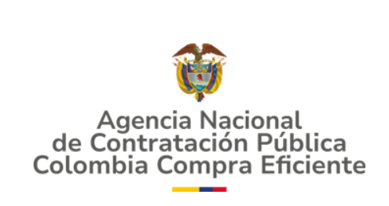

# 🏛️ Observatorio de Contratación – Prestación de Servicios (OPS 2018–2026)



Dashboard analítico interactivo en **Streamlit** para la **Agencia Nacional de Contratación Pública – Colombia Compra Eficiente (ANCP – CCE)** sobre la contratación por **Prestación de Servicios (OPS)** en SECOP I y SECOP II durante las vigencias **2018–2026**.

## ✨ Estructura del Dashboard

1. **Portada Ejecutiva (`app.py`):**
   - **Panel Ejecutivo Principal (según bosquejo oficial):** Número total y valor total de contratos de prestación de servicios, desglose por carácter territorial (`NACIONAL`, `DEPARTAMENTAL`, `MUNICIPAL`), total de entidades y conteo de entidades nacionales, departamentales y municipales.
   - Gráficos interactivos de participación territorial, evolución anual 2018–2026, distribución binaria (`PERSONA NATURAL` / `PERSONA JURIDICA`), transición SECOP I → SECOP II y mapa de calor geográfico.
2. **🏢 Entidades y Sectores (`pages/1_🏢_Entidades_y_Sectores.py`):** Buscador y ficha técnica por entidad, rankings Top N, sectores institucionales, tipologías del objeto y directorio descargable.
3. **🗺️ Territorial (`pages/2_🗺️_Territorial.py`):** Mapas de calor coropléticos y de densidad para 33 departamentos y 1.100+ municipios DANE DIVIPOLA con auto-zoom, matriz 2D y rankings.
4. **📅 Evolución y Gobiernos (`pages/3_📅_Evolucion_y_Gobiernos.py`):** Comparativo por periodo presidencial (Santos II cierre 2018, Duque 2018–2022, Petro 2022–2026), serie mensual con ventanas de Ley de Garantías y matriz de estacionalidad.
5. **👥 Proveedores y Recurrencia (`pages/4_👥_Proveedores_y_Recurrencia.py`):** Persona Natural vs. Jurídica, enfoque de género, multiplicidad anual ("Carrusel OPS") y continuidad interanual en la misma entidad.
6. **📥 Bases y Descargas (`pages/5_📥_Bases_y_Descargas.py`):** Ficha metodológica y exportación CSV (UTF-8 con BOM).

## 🚀 Cómo ejecutarlo localmente

Desde la carpeta raíz del proyecto:
```powershell
& "C:\ProgramData\anaconda3\Scripts\streamlit.exe" run dashboard_ops\app.py
```
O haciendo doble clic en `iniciar_dashboard_ops.bat`.

Si necesitas regenerar las bases `.parquet` tras actualizar los CSV fuente:
```powershell
& "C:\ProgramData\anaconda3\python.exe" dashboard_ops\build_dashboard_data.py
```
